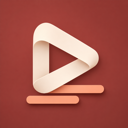
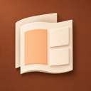
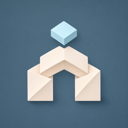
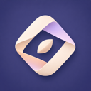
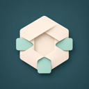

# 造隅全系列名称与图标资源

归档 2026-11-04 已整理的 18 款应用设计，采用第三版单词式英文名称。
套件中文名为 **造隅**，英文统称 **ZAOYU**。工程设备范围为平板与 2in1
（`tablet`、`2in1`），包名前缀统一为 `com.richerfu`。

应用身份与集成状态以 [config/apps.json](../../config/apps.json) 为准。
这里的清单记录本次归档时的对应关系；后续更名时需同步 JSON、CSV、文字清单和 HTML。
设计资源覆盖全部 18 款，包含已接入的 7 款编辑器、Nodune 入口及 10 款待接入应用。

## 浏览与下载

- [离线交互图册](index.html)：克隆或下载仓库后用浏览器打开，支持搜索、尺寸、圆角／圆形预览及 PNG 下载。
- [原设计总览](overview.png)及[小尺寸／遮罩预览](size-and-mask-preview.png)：保留原始图片。
- [完整名称与设计清单 JSON](names.json) / [CSV](names.csv)：包含用途、词根、配色、设计描述、图标路径及原图 SHA-256。
- [精简名称与包名 JSON](bundle-names.json) / [CSV](bundle-names.csv) / [TXT](bundle-names.txt)。
- [命名说明](naming-notes.txt)与[原始图标生成提示词](generation-prompts.txt)。

原设计总览和提示词里的“手机与平板”是生成时记录，当前工程仅支持平板和 2in1。
原提示词中的旧英文称呼也仅用于追溯；当前名称见下表。图标画面及所有 PNG 文件均保持原样。

## 应用对应

| 图标 | 原应用 | 中文名称 | 英文名称 | 包名 | 归档时状态 |
| --- | --- | --- | --- | --- | --- |
|  | PhotoCraft | 造隅修图 | Pixrune | `com.richerfu.pixrune` | 已接入 |
|  | VectorCraft | 造隅矢绘 | Vecrune | `com.richerfu.vecrune` | 已接入 |
|  | FilmCraft | 造隅剪辑 | Cliprune | `com.richerfu.cliprune` | 已接入 |
|  | LightCraft | 造隅光影 | Lutrune | `com.richerfu.lutrune` | 待接入 |
|  | PdfCraft | 造隅阅编 | Pagrune | `com.richerfu.pagrune` | 已接入 |
|  | EffectCraft | 造隅动效 | Motrune | `com.richerfu.motrune` | 已接入 |
|  | DesignCraft | 造隅版式 | Layrune | `com.richerfu.layrune` | 已接入 |
|  | FigCraft | 造隅界面 | Framune | `com.richerfu.framune` | 待接入 |
|  | TextureCraft | 造隅纹绘 | Texune | `com.richerfu.texune` | 待接入 |
|  | MaterialCraft | 造隅材质 | Shadrune | `com.richerfu.shadrune` | 待接入 |
|  | WordCraft | 造隅文档 | Quilrune | `com.richerfu.quilrune` | 待接入 |
|  | SoundCraft | 造隅音轨 | Sonune | `com.richerfu.sonune` | 待接入 |
|  | DeckCraft | 造隅演示 | Deckune | `com.richerfu.deckune` | 待接入 |
|  | CADCraft | 造隅工图 | Dimrune | `com.richerfu.dimrune` | 待接入 |
|  | GridCraft | 造隅表格 | Gridrune | `com.richerfu.gridrune` | 已接入 |
|  | Craft Anything | 造隅构建 | Modune | `com.richerfu.modune` | 待接入 |
|  | ArtCraft Studio | 造隅灵绘 | Visrune | `com.richerfu.visrune` | 待接入 |
|  | ArtCraft Launcher | 造隅工坊 | Nodune | `com.richerfu.nodune` | 已接入 |

## 图标规格与工程用法

| 目录 | 尺寸 | 内容 |
| --- | --- | --- |
| [icons/masters](icons/masters/) | 1254 × 1254 | 18 张生成原图，保留 SHA-256 |
| [icons/1024](icons/1024/) | 1024 × 1024 | 18 张大尺寸 PNG |
| [icons/512](icons/512/) | 512 × 512 | 18 张启动图标资源 |
| [icons/256](icons/256/) | 256 × 256 | 18 张中尺寸 PNG |
| [icons/128](icons/128/) | 128 × 128 | 18 张应用内标志 |

共 90 张图标 PNG，另有 2 张预览图。文件名沿用稳定的编号与用途标识，
例如 `02-vector.png` 对应 Vecrune；名称与文件的映射见 `names.json`。

已接入应用的 512px 图标用于 `AppScope/resources/base/media/<product>_icon.png`
和 `entries/<product>/src/main/resources/base/media/app_icon.png`；
7 款 Rust 编辑器的 128px 图标位于 `branding/<product>-128.png`。
此目录保存完整设计资源，不自动参与应用打包。调整图标时需同步对应运行时资源。

图标采用象牙白折面主体、功能轮廓与分色背景，图标内不含文字。
所有图标保留完整方形背景，圆角与圆形仅为图册展示裁切。
导出图为不透明 RGB PNG；母版是栅格 PNG，不包含可编辑矢量或独立前景／背景图层。

## 来源与记录

图标由用户要求的独立品牌设计任务通过内置 imagegen 逐款生成，常用尺寸由原图等比缩小。
本次归档仅将包名从占位前缀更新为工程中的 `com.richerfu.*`，同步设备说明与集成状态。
原始 PNG、生成提示词和命名检索记录未改动；`names.json` 中的
`previousEnglishName` 用于保留更名历史。

名称检索记录属于当时的有限初筛，不代表商标或商店注册已通过。
上游名称仅用于来源对照，代码与第三方素材许可记录见 [ASSETS.md](../../ASSETS.md)
和 [licenses](../../licenses/)。
